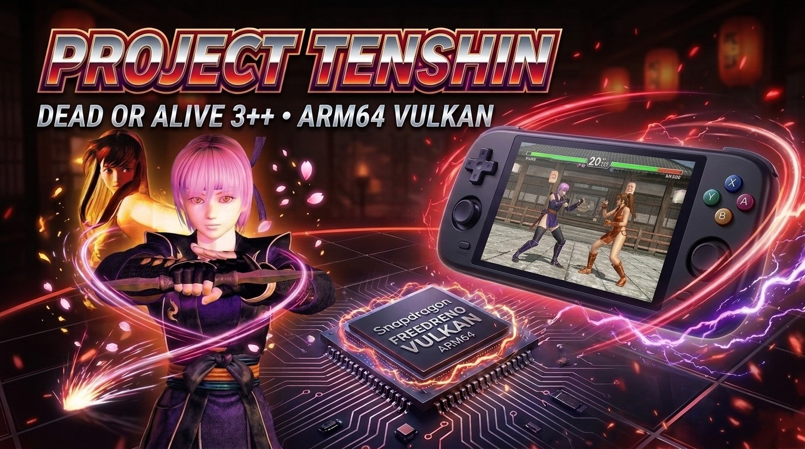

<p align="center">
  
</p>

# ProjectTenshin — Dead or Alive 3++ Linux / Vulkan Port (x86_64 + ARM64)

[](https://github.com/DanimanX/ProjectTenshin/actions/workflows/build-arm64.yml)
[](https://github.com/DanimanX/ProjectTenshin/actions/workflows/build-linux-x86_64.yml)
[](LICENSE)

A native **Linux & Vulkan** port of [NoRain211/doa3-re](https://github.com/NoRain211/doa3-re) (static recompilation of **Dead or Alive 3 / DOA3++** — Original Xbox) for two Linux targets:

- **x86_64** handhelds, desktops and laptops through **Mesa Intel ANV** or **RADV (AMD)** — MSI Claw, ROG Ally, Legion Go, any Vulkan 1.3 machine. See [docs/x86_64-linux.md](docs/x86_64-linux.md).
- **ARM64 (AArch64)** on **Qualcomm Snapdragon** Linux devices through **Mesa Freedreno / Turnip** (`libvulkan_freedreno.so`) — see [docs/snapdragon-freedreno.md](docs/snapdragon-freedreno.md).

Inspired by the cross-compilation and platform-engineering structure of [ProjectDural](https://github.com/DanimanX/ProjectDural), **ProjectTenshin** pairs `doa3-re`'s static x86→C lifter (`xboxrecomp`) and native fiber/runtime layer with a **Zig 0.17.0** `aarch64-linux-gnu.2.28` cross-build pipeline for Snapdragon, a native host build for x86_64, and **Vulkan** optimizations for both (Freedreno/Turnip specifics on ARM64, hybrid-CPU thread pinning on x86_64).

> **Bring Your Own Data (BYOD):** Zero copyrighted Xbox binaries, game assets, or ROM-derived compiled code are included in this repository or its releases. You must supply your own legally obtained *Dead or Alive 3* Xbox disc (Japan 3.1 recommended, USA 3.0, or Europe 3.2) and build your local runner with `./build_game.sh` (x86_64) or `tools/build-arm64-game.sh` (Snapdragon).
>
> *"Dead or Alive 3"* is a trademark of Koei Tecmo Games / Team Ninja. *"Snapdragon"* and *"Adreno"* are trademarks of Qualcomm Incorporated. This project is independent and not affiliated with any rights holder.

---

## Hardware Scope & 60 FPS Target on Snapdragon + Freedreno (Turnip)

Original Xbox runs *Dead or Alive 3* at **60.0 FPS** (`16.67 ms` frame budget) on a 733 MHz Pentium III + NVIDIA NV2A GPU. Unlike budget quad-core Cortex-A53 / Mali-G31 handhelds (which lack Vulkan and memory bandwidth for an Xbox static recompilation), **ProjectTenshin** targets **Qualcomm Snapdragon ARM64 Linux** hardware with open-source **Mesa Freedreno / Turnip** Vulkan 1.3 drivers.

| Subsystem | Original Xbox Target | Snapdragon + Freedreno Linux ARM64 | ProjectTenshin Engineering |
|---|---|---|---|
| **CPU** | Intel Pentium III Coppermine (x86-32 @ 733 MHz, SSE1 + x87) | **Snapdragon 865 / 870 / 888 / 8 Gen 1–3 / G3x Gen 2** (`aarch64` Prime + Gold + Silver) | Static AOT x86→C recompilation (`xboxrecomp`) compiled to native AArch64 with `-ffp-contract=off -fno-strict-aliasing -fwrapv` (`RECOMP_PORTABLE_MATH`), ELF AArch64 cooperative fiber switcher (`fiber_switch_arm64.S`), and **Snapdragon big.LITTLE cluster scheduler** (`platform/arm64/thread_affinity.h`) pinning guest execution to Prime/Gold cores while keeping Mesa/SDL worker threads unpinned. |
| **GPU** | NVIDIA NV2A (Direct3D 8.1, vertex programs, DXT1/3/5, D24S8, pixel combiners) | **Qualcomm Adreno 6xx / 7xx** running **Mesa Freedreno / Turnip Vulkan** (`libvulkan_freedreno.so`) | **SDL3 GPU Vulkan backend** (`d3d_presenter_sdl_gpu.cpp`) with **Adreno-native `D24_UNORM_S8_UINT` UBWC/LRZ depth selection**, **persistent on-disk SPIR-V shader cache** (`platform/arm64/vulkan_freedreno.h`), automatic `A8_UNORM` → `BGRA8` fallback when `VK_KHR_maintenance5` is absent, and optional `RECOMP_VK_SIMPLE_WATER=1` for Adreno 6xx water stages. |
| **Audio** | NVIDIA MCPX APU + DirectSound 3936 + Xbox ADPCM + CRI Sofdec | Linux PipeWire / PulseAudio / ALSA via **SDL3 Audio** | Native `audio_output_sdl.cpp` with Xbox ADPCM decoding, 3D distance attenuation, Doppler, HRTF, stereo reverb, and native CRI Sofdec movie playback. |
| **RAM** | 64 MB unified DDR | 4 GB – 16 GB LPDDR4X / LPDDR5X | Clean 64 MB guest memory map + dynamic Vulkan ring buffers + disk-backed SPIR-V shader cache (~300–550 MB total RSS at 2×–3× internal scale). |
| **Display** | 480i / 480p (4:3, anamorphic 16:9) | 720p / 1080p / 1440p OLED/IPS Linux displays | Native **1×–8× internal resolution scaling** (`RECOMP_D3D_SCALE`), MSAA 2×/4× (`RECOMP_D3D_MSAA`), true **16:9 / 16:10 / Ultrawide** 3D frustum expansion with preserved 4:3 HUD, and `RECOMP_FULLSCREEN=1`. |

### Target Snapdragon + Freedreno Hardware Matrix

Compiled for **`aarch64-linux-gnu` / `glibc <= 2.28`** (statically linking `libc++` via Zig 0.17.0, dynamically linking the system's `libSDL3.so.0`, Vulkan loader `libvulkan.so.1` → Mesa Turnip `libvulkan_freedreno.so`, and runtime `libshaderc`):

| Target Class | Example Devices | SoC / Adreno GPU | Recommended Build Profile | Expected Performance |
|---|---|---|---|---|
| **Snapdragon 865 / 870** | Retroid Pocket 5 / Mini / Flip 2, Snapdragon Linux tablets/phones | 1× A77 + 3× A77 + 4× A55 · **Adreno 650** (Freedreno/Turnip) | `TARGET_CPU=cortex_a77`, `RECOMP_D3D_SCALE=2`, `RECOMP_VK_DEPTH_FORMAT=d24s8` | **60 FPS** @ 960p/1080p *(use `RECOMP_VK_SIMPLE_WATER=1` on heavy water stages if needed)* |
| **Snapdragon 8 Gen 2 / G3x Gen 2** | AYN Odin 2 / Mini / Portal, AYANEO Pocket S / EVO / DMG | 1× X3 + 4× A715/A710 + 3× A510 · **Adreno 740 / A32** (Turnip) | `TARGET_CPU=cortex_x3`, `RECOMP_D3D_SCALE=3`, `RECOMP_D3D_MSAA=2` | **60 FPS locked** @ 1080p–1440p with full modern SSR water |
| **Snapdragon 845 / 855** | PostmarketOS / Arch Linux ARM phones & SBCs | 4× Kryo Gold + 4× Kryo Silver · **Adreno 630 / 640** (Turnip) | `TARGET_CPU=generic`, `RECOMP_D3D_SCALE=1`, `RECOMP_VK_SIMPLE_WATER=1` | **60 FPS** @ 480p–720p |
| **Snapdragon X / Linux Laptops & SBCs** | Snapdragon 8cx / X Elite Linux ARM64 | Oryon / Kryo · **Adreno** (Turnip) | `TARGET_CPU=generic`, `RECOMP_D3D_SCALE=3`, `RECOMP_D3D_MSAA=4` | **60 FPS locked** @ 1440p+ |

---

## Architecture: Linux ARM64 + Freedreno Vulkan Pipeline

```text
  [1. ROM-Free Distributable Package — tools/build-arm64.sh]
    ProjectTenshin-Linux-ARM64-Vulkan.tar.gz
      ├── run_arm64_vulkan.sh            (Freedreno ICD, SPIR-V cache, env tuning)
      ├── launcher.aarch64               (SDL3 gamepad/keyboard settings launcher)
      ├── tenshin_vk_probe.aarch64       (Snapdragon CPU + Freedreno Vulkan hardware probe)
      └── tenshin_runtime_test.aarch64   (AArch64 fiber + math + D3D8/DSound self-test)

  [2. Local BYOD Game Binary — tools/build-arm64-game.sh /path/to/doa3.iso]
    User's legal DOA3 ISO (Japan 3.1 / USA 3.0 / Europe 3.2)
         │
         ├──► tools/xboxrecomp (x86 default.xbe -> authenticated C chunks)
         ├──► Zig 0.17.0 cross-compile (aarch64-linux-gnu.2.28, -ffp-contract=off)
         └──► doa3.aarch64
                ├── Prime/Gold cluster: Guest x86-lifted C + fiber_switch_arm64.S
                ├── Unpinned workers:   SDL3 Audio (ADPCM/HRTF/Reverb) + Mesa Turnip
                └── SDL3 GPU Vulkan:    D24S8 UBWC/LRZ + Persistent SPIR-V Disk Cache
```

---

## Quick Start

### 1. Build the ROM-Free Linux ARM64 Toolchain & Diagnostics (on Linux x86_64)

Requires `curl`, `git`, `python3`, `tar`, `binutils`. Zig 0.17.0, SDL3 3.4.12 headers, and Dear ImGui 1.91.9 are fetched automatically with verified SHA-256 checksums:

```bash
tools/build-arm64.sh
# Or target Snapdragon 8 Gen 2 / G3x Gen 2:
TARGET_CPU=cortex_x3 tools/build-arm64.sh
```

This verifies every binary (`ARM aarch64`, max `GLIBC_2.28`, zero `libstdc++.so`) and outputs **`dist/ProjectTenshin-Linux-ARM64-Vulkan.tar.gz`**.

The x86_64 package is built natively, with the host compiler, so run this on x86_64 Linux:

```bash
tools/build-linux-x86_64.sh
```

It outputs **`dist/ProjectTenshin-Linux-x86_64-Vulkan.tar.gz`** holding the runtime self-test, the Linux host-layer test, the Vulkan probe and `run_linux_vulkan.sh`.

### 2. Run the Host Verification Suite (Zero Game Files Needed)

```bash
tools/build-host-test.sh
```

Runs all Python tooling tests, builds `recomp-runtime` + `projecttenshin-freedreno-vulkan` + `tenshin_vk_probe`, and executes the entire CTest suite (including the SDL3 GPU Vulkan presenter tests when Vulkan/Lavapipe and `libshaderc` are installed). It builds for the host it runs on: x86_64 or ARM64.

### 3. Build Your Own Legal DOA3 Runner (BYOD)

On **x86_64 Linux** (including SteamOS handhelds), from the extracted release archive or a clone:

```bash
git submodule update --init tools/xboxrecomp
./build_game.sh /path/to/doa3.iso
./launcher.sh            # settings screen, then the game
```

`./tools/steam_shortcut.py add --restart-steam` adds the library entry that Steam Game Mode's menu needs; see [docs/x86_64-linux.md](docs/x86_64-linux.md#4-steam-game-mode).

On **Snapdragon ARM64**, cross-compile the game from an x86_64 host or build natively on the device:

```bash
git submodule update --init tools/xboxrecomp
tools/build-arm64-game.sh /path/to/doa3.iso
# Optional: skip 3.4 GB FMV movies on smaller storage
tools/build-arm64-game.sh /path/to/doa3.iso --no-movies
```

Copy `dist/ProjectTenshin-Linux-ARM64-Vulkan/` (now containing your locally built `doa3.aarch64`) and your extracted disc folder (`private/play-disc-jp/` or `private/play-disc/`) onto your Snapdragon Linux ARM64 device, verify Vulkan readiness, and play:

```bash
./tenshin_vk_probe.aarch64
./run_arm64_vulkan.sh
```

---

## Snapdragon / Freedreno Vulkan Tuning Options

Create a `tenshin.env` file beside `run_arm64_vulkan.sh` (or export environment variables):

| Variable | Default | Description |
|---|---|---|
| `RECOMP_D3D_SCALE` | `2` | Internal render scale multiplier (`1`–`8`; `2` = 960p/1280×960, `3` = 1440p). |
| `RECOMP_D3D_MSAA` | `1` | Hardware MSAA sample count (`1`, `2`, `4`, `8`) validated against Adreno format support. |
| `RECOMP_D3D_WIDESCREEN` | `16:9` | Aspect ratio (`4:3`, `16:9`, `16:10`, or custom `W:H`) with true 3D frustum widening & 4:3 HUD. |
| `RECOMP_VK_DEPTH_FORMAT` | `auto` | `auto` selects `D24_UNORM_S8_UINT` on Freedreno/Snapdragon for Adreno UBWC/LRZ tiling; force `d24s8` or `d32s8`. |
| `RECOMP_VK_SIMPLE_WATER` | `0` | Set `1` to disable the 24-step raymarched SSR water pass on Adreno 6xx (SD845/SD865) for locked 60 FPS on water stages. |
| `PROJECTTENSHIN_SHADER_CACHE` | `~/.cache/projecttenshin/spirv` | Persistent on-disk SPIR-V shader cache directory (`PROJECTTENSHIN_DISABLE_SHADER_CACHE=1` to disable). |
| `PROJECTTENSHIN_PIN_PERF` | `1` | Pins the guest execution thread to Snapdragon's Prime/Gold performance cluster while leaving Vulkan/SDL workers unpinned. |
| `RECOMP_FULLSCREEN` | `0` | Set `1` to start directly in fullscreen mode on Linux ARM64 handhelds. |
| `RECOMP_PERF_COUNTER` | `0` | Set `1` to print per-second FPS, frame time, worst frame spike, and draw call count to `stderr`. |

See [docs/snapdragon-freedreno.md](docs/snapdragon-freedreno.md) for full Mesa Turnip setup, system packages (`libSDL3`, `libshaderc`, `mesa-vulkan-drivers`), and troubleshooting.

---

## Default Controls

| Action | Gamepad Default | Keyboard Default |
|---|---|---|
| **Move / Sidestep** | D-Pad / Left Stick | Arrow Keys |
| **Free / Hold (F)** | X | A |
| **Punch (P)** | Y | S |
| **Kick (K)** | B | X |
| **Throw (F+P)** | A / LB | Z / Q |
| **Tag / P+K** | RB | W |
| **Triggers (Macros)** | LT / RT | E / R |
| **DOAXBV Swimsuits** | L3 (Left Stick Click) | Tab |
| **Free Camera** | R3 (when enabled) | F1 |
| **Start / Pause** | Start | Enter |
| **Quit Prompt** | Hold Back (2s) | Hold Backspace (2s) |

---

## Upstream Attribution & Licence

- Upstream static recompilation & runtime: **[NoRain211/doa3-re](https://github.com/NoRain211/doa3-re)** and **[NoRain211/xboxrecomp](https://github.com/NoRain211/xboxrecomp)** (plus shared runtime from [NoRain211/doaxbv-re](https://github.com/NoRain211/doaxbv-re)).
- Port engineering & Zig ARM64 pipeline structure: inspired by **[DanimanX/ProjectDural](https://github.com/DanimanX/ProjectDural)**.
- Licence: **[GPL-3.0-or-later](LICENSE)** (see also [NOTICE](NOTICE)). Third-party dependencies (SDL3, Dear ImGui, miniupnpc, Mesa Freedreno/Turnip) retain their respective licences.
- This licence grants **no rights** to *Dead or Alive 3*, *Dead or Alive 3++*, or any copyrighted game files; game data is never distributed.
